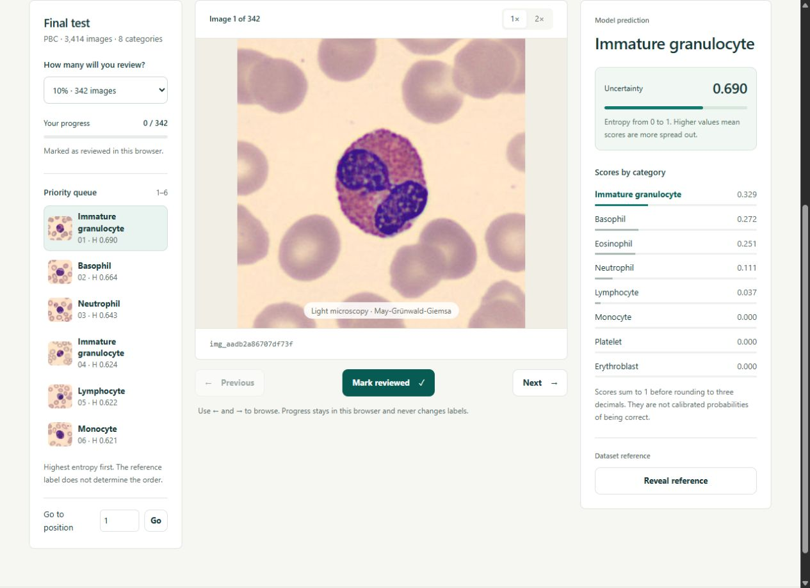

# CellReview

**Uncertainty-guided review of blood-cell image predictions.**

[Live demo](https://huggingface.co/spaces/Dwagga/cellreview) · [Technical note](TECHNICAL_NOTE.md) · [Recalculate results](science/README.md) · [Portfolio](https://davidmendezmerino.com/)



When review capacity is limited, which images should be inspected first? CellReview ranks blood-cell images by the entropy of a classifier's eight scores, then compares prediction–reference disagreement retrieval with random selections of the same size.

The application provides an interactive review queue, class scores, review budgets, a confusion matrix and results calculated from saved predictions. Review progress stays in the browser. The demo runs without model inference or training.

## Method and results

- A frozen ImageNet-pretrained ResNet18-v1 ONNX feature extractor, followed by standardisation and logistic regression.
- 10,246 training images, 3,414 development-validation images and 3,414 held-out internal test images from PBC.
- Entropy-based ranking, evaluated at review budgets of 5%, 10%, 20% and 40%, against 1,000 random selections per budget.

| Final internal test | Result |
| --- | ---: |
| Accuracy | 84.0656% |
| Macro-F1 | 0.8335173 |
| Prediction–reference disagreements | 544 |
| Disagreements found in the top 342 images (10%) | 194 |
| Random mean at the same review budget | 54.281 |

The 10% review queue finds approximately **3.57 times as many disagreements** as the random mean. It captures 194 of 544 disagreements; 350 remain outside that selection. This is an internal, retrospective dataset evaluation. Patient-independent separation, external-hospital performance and clinical benefit have not been established. See the [technical note](TECHNICAL_NOTE.md) for the complete method and limitations.

## Run the application locally

Python 3.12 is recommended. The static interface itself needs no Python packages or GPU.

```sh
git clone https://github.com/Davidmendezmerino/cellreview.git
cd cellreview
python scripts/download_images.py
python -m http.server 8766 --bind 127.0.0.1
```

Open **http://127.0.0.1:8766**. On systems where the command is `python3`, use that instead of `python`.

Images are downloaded from the pinned public Hugging Face revision and checked against the original SHA-256 manifest. The default downloads the final-test images used by the interface; `--collection both` also downloads development-validation images. The image files are excluded from Git to keep the repository small. Attribution is in [DATA_NOTICE.md](DATA_NOTICE.md).

## Verify the published results

No image downloads or model weights are needed for this check. With Python 3.12:

```sh
python -m pip install -r science/requirements.txt
python -B science/verify_results.py --collection both
```

This recalculates metrics, ranking, review budgets and random comparisons from the saved class scores. It **does not retrain the model or reproduce image inference**. The original scientific files and prediction data are preserved byte for byte. [Verification details](science/README.md).

## Repository layout

| Path | Contents |
| --- | --- |
| `index.html`, `app.js`, `app.css` | Static review application |
| `data/` | Saved predictions and collection metadata |
| `science/` | Original evaluation functions and result verifier |
| `manifest.json` | File hashes, image hashes and provenance |
| `scripts/download_images.py` | Download and verify the image assets |
| `TECHNICAL_NOTE.md` | Model, split, results and limitations |

**Author:** David Méndez Merino. Images: Acevedo et al. (2020), PBC v1, [DOI 10.17632/snkd93bnjr.1](https://doi.org/10.17632/snkd93bnjr.1), CC BY 4.0. The image licence does not assign a licence to the application code or pretrained model weights. [Source revision and GitHub packaging](SOURCE.md).
